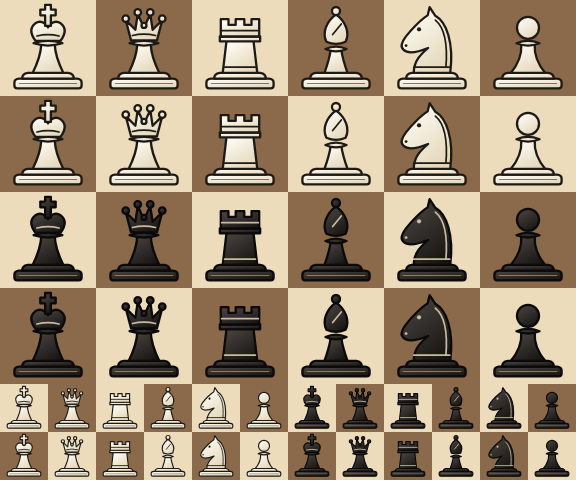

# A product's own artwork and text: SVG drawings and the monospaced family

The drawing layer reads two kinds of SVG and draws text in two families. This page is for a product that draws its own
artwork - icons, chess pieces - and sets text in columns, a log or an engine's output.

## Two SVG readers

| Reader | Draws | By whose rules |
|---|---|---|
| `gfx::SvgArt` (`gfx/SvgArt.h`) | the series' backlit meters' face and glass (`assets/meters`) | JUCE's parser's, quirk for quirk, so a meter shows the face the releases built on JUCE showed: a gradient's first stop moved to the start, a stroke's width scaled by the transform's determinant, a shape with no fill filled black only where its outline closes |
| `gfx::SvgImage` (`gfx/SvgImage.h`) | a product's own drawings | the SVG specification's, as a browser draws them |

Both read the text through `gfx::SvgSyntax` (`gfx/SvgSyntax.h`): the XML as a tree of elements, refusing text,
entities, CDATA and doctypes, and the numbers, colours and references in the attributes, read whatever the process's
locale. Neither draws anything it has not been taught to draw as its rules say: each refuses a document outside its
subset with the reason - the element, the attribute or the text by name - so a drawing that needs more fails where it
is read, in a suite, rather than drawing wrong in a window.

`SvgImage` reads:

- the root `<svg>` - `viewBox`, or a `width` and `height` from the origin; `preserveAspectRatio` in every alignment,
  meet or slice, or none;
- `<g>` with `transform`, and the shapes `<path>`, `<circle>`, `<ellipse>`, `<rect>` (with `rx` and `ry`), `<line>`,
  `<polyline>` and `<polygon>`;
- path data of every command, absolute and relative - M L H V C S Q T A Z - with the grammar's implicit repeats, its
  numbers run together and an arc's flags unspaced; an arc is drawn as cubic curves of a quarter turn or less;
- transform lists of `matrix`, `translate`, `scale`, `rotate` (about the origin or a point), `skewX`, `skewY`;
- `<linearGradient>` in `<defs>`, in the painted shape's bounds (the default) or the drawing's units, with `<stop>`s;
- fill, fill-opacity, fill-rule, stroke, stroke-width, stroke-opacity, stroke-linejoin, stroke-linecap,
  stroke-miterlimit (4, the specification's default), stroke-dasharray - all inherited down the tree - and opacity,
  which draws the element and everything in it as one layer;
- colours `#rgb`, `#rrggbb`, black, white, `none` and `url(#id)` of a gradient.

A gradient in the shape's bounds is exact for any box, square or not: the blend is linear in the box's units, so it is
linear in the shape's, and the reader hands the canvas the one gradient between two points of the shape's units that
gives every point the colour the box's units give it - its lines of one colour slanted as a wide box slants them.

The fill rule is a property of `gfx::Path` (`Path::SetFillRule`, the non-zero rule unless a path asks for even-odd),
which the Skia canvas hands to Skia and `Path::Contains` honours.

### Drawing one

```cpp
#include "SvgImage.h"

const auto king = reckless::gfx::SvgImage::Parse(text, &error); // none, with the reason, for what it does not draw
king->DrawIn(canvas, square);              // the viewBox fitted into the square, its aspect kept, centred
king->Draw(canvas, transform);             // or through any transform from the drawing's units
```

`ViewBox()` is the drawing's own units and `FitTransform(area)` the transform `DrawIn` uses. Parse once and keep the
`SvgImage`; drawing walks the shapes it holds and parses nothing. A stroke's width, its dashes and the gradients scale
with the transform the drawing is drawn through, so a piece drawn at 40 pixels and at 160 is the same piece.

### The chess pieces

The Skia suite draws a set of piece SVGs, two kept as fixtures (`tests/svg/wK.svg`, `tests/svg/bN.svg`) and every one
in the directory `RECKLESS_SVG_PIECES` names, into transparent squares of 64 and 160 pixels and holds each to an opaque
body in the piece's colour, a dark outline and transparent corners, covering the same share of the square at both sizes.
With `RECKLESS_SCREENSHOT_DIR` set too it writes them on light and dark squares at 96 pixels, and every piece at 48:



## The monospaced family

`gfx::Font` has a family, `gfx::FontFamily`: `kSerif`, the series' Noto Serif and every font's unless it asks for
another, and `kMonospace`, Monaspace Xenon - every character one advance, regular and bold on the same grid. A product
chooses it per run of text:

```cpp
canvas.SetFont(reckless::gfx::Font(13.0f).WithFamily(reckless::gfx::FontFamily::kMonospace));
canvas.DrawText("info depth 24 score cp 31 pv e2e4", area, reckless::gfx::Justify::kCentredLeft);
```

A font in the family is sized as the serif is - its height the face's ascent and descent together - and takes the
bold face, the tracking and the horizontal scale as the serif does. At 13 pixels every printable ASCII character
advances 7.04 pixels, the bold face's too.

### Opting in

The fonts are carried inside a binary only when its product asks for them, so a binary that never draws the family -
every plug-in of the suite - is no bigger for it:

```cmake
reckless_monospace_font_files(monospace)                  # MonaspaceXenon-Regular.otf=..., MonaspaceXenon-Bold.otf=...
reckless_module_assets(my_app_assets ${monospace})        # beside the serif, the knob and the mark
```

and at run time, once, before the family draws anything, beside the serif's faces:

```cpp
reckless::gfx::SetMonospaceFaces(reckless::embedded::Find("MonaspaceXenon-Regular.otf"),
                                 reckless::embedded::Find("MonaspaceXenon-Bold.otf"));
```

Until the faces are set, text in the family draws in the serif. Setting them changes nothing the serif draws: the Skia
suite measures and draws the serif's text before and after, pixel for pixel.

The two files are the static OTFs of Monaspace's release v1.400, unmodified, under the SIL Open Font License 1.1 with
the reserved names "Monaspace" and "Xenon" - so a copy that is changed in any way, subset or converted, may not keep
those names. Their licence, `assets/fonts/monaspace/OFL.txt`, goes with every copy, as the serif's does
(`assets/fonts/OFL.txt`); the toolkit's `NOTICE` names the release and its hash.
