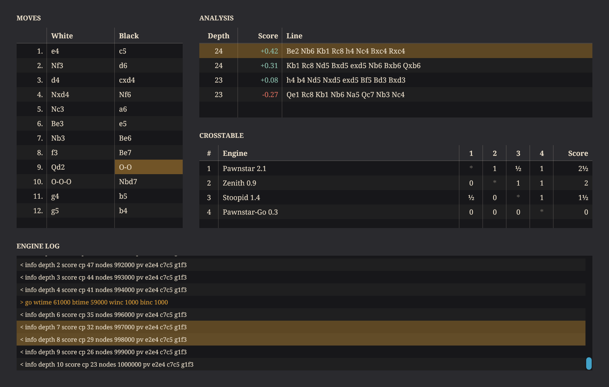
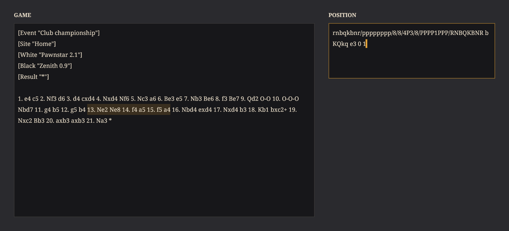

# The views that show many lines

A product that shows text by the screenful - a game's moves, an engine's analysis lines and its log, a tournament's
crosstable, a game's score as text, a position's notation - builds on the list view (`view/ListView.h`) and the text
view (`view/TextView.h`), dressed in the series' look by `panel/ListStyles.h`.

## The list: `view::ListView`

Many rows of one height, scrolled, over a model the owner keeps (`view::ListModel`):

| The model answers | For |
|---|---|
| `RowCount()` | how many rows there are |
| `CellText(row, column)` | a cell's text, for the view's own painting and for a copy of the selection |
| `CellColour(row, column)` | a cell's own text colour - a score's - or the style's |
| `CellBackground(row, column)` | a fill behind one cell - the move a game stands at |
| `PaintRow(canvas, row, bounds, selected)` | a row painted whole by the model, in place of its cells |

The view asks only for the rows the screen shows: a paint of a list of fifty thousand rows asks for the ten or eleven
in view, and a repaint of one row's area asks for that row. When the model's rows change, the owner calls
`RowsChanged()`; the count is read again, the selection held to it and the scroll range set.

- **Columns**: `SetColumns`, each a `view::ListColumn` - a title for the header row, a fixed width in pixels or, at
  width 0, a share (`weight`) of what the fixed columns leave, and where its text sits. No columns is one column across
  the list and no header.
- **Selection**: `SetSelectionMode` - none, one row, or any rows in ranges (`view::RowSelection`, sorted ranges, so a
  selection of every row is one range). A press selects, Shift extends from the anchor, Command toggles a row, a drag
  extends; Up and Down, Page Up and Page Down, Home and End move, Shift extending; Command-A selects every row, Return
  tells `on_activate`, Command-C hands the selection's text - cells parted by tabs, rows by line breaks - to `on_copy`.
- **Callbacks**: `on_click`, `on_double_click` (row and column), `on_context_click` (the row under a right click, which
  it selects first, and where it landed), `on_header_click`, `on_selection_changed`, `on_activate`, `on_copy`.
- **Scrolling**: the wheel (three rows a notch, handed to the parent when every row shows) and the series' scroll bar
  beside the rows, shown only while some are hidden; `ScrollToRow`, `ScrollToBottom`, `SetScroll`. With
  `stick_to_bottom`, a list at its bottom stays there as rows arrive and as it is resized, and a list the person has
  scrolled up stays where it is - an engine's log.

`panel::ListViewStyle(palette, font)` dresses a list in the series' look: the rows on the plate's colour, as the
series' screens are, in the ink; the header on the panel's colour in the font's bold; every other row striped and the
columns parted by the ink at a fraction; the selection in the accent at the strength a menu lights its row; the
rows one and a half times the font's height. The font is the caller's, so a list of figures may be set in a
fixed-pitch face.

## The text: `view::TextView`

Many lines of UTF-8 text, scrolled, read-only by default (`SetEditable(true)` to edit). `SetText` takes text with any
line breaks and in any encoding: `NormalisedText` makes every break a line feed and each broken part of the UTF-8 one
U+FFFD, so every place in the text - the caret, the selection's ends, a wrap's point - is a byte offset at a
character's start, never inside one (`NextCodePointStart`, `PreviousCodePointStart`).

- **Layout**: `WrapLines` breaks the text at every line feed and, with `word_wrap` (the default), wherever the next
  word would pass the view's width, the spaces before the break hanging at the line's end, and a word wider than the
  line between characters. Every width is the window's measure (`Host::TextWidth`), as the canvas draws the text, so
  the serif and a fixed-pitch face both lay out as drawn. The scroll bar's width is taken only when the lines need it.
  A paint draws only the lines that show; `Lines()`, `LineOf`, `PointOf` and `PositionAt` read the layout.
- **Selection**: a press puts the caret, Shift extends, a drag extends, a double click selects a word. Left and Right
  (a word with Alt; the line's ends with Command), Up and Down (keeping the column the moves began in; the text's ends
  with Command), Home and End (the line's; the text's with Command), Page Up and Page Down, Shift extending; Command-A
  selects everything, Command-C hands the selection to `on_copy` for the owner to put on the clipboard.
- **Editing**: typing in place of the selection, Return for a line feed, Backspace and Delete (a word with Alt),
  Command-X (to `on_copy`, then out), Command-V (the clipboard's text through `Host::ClipboardText`, its breaks made
  line feeds); `InsertText`, `Cut`, `Paste` and `Copy` for a menu's items; `on_change` hears the text after each edit,
  never after `SetText`. The caret is a 2 px bar while the view and the window hold the keyboard. There is no undo.
- **Scrolling**: the wheel (three lines a notch) and the series' scroll bar; every move of the caret scrolls as
  little as shows it.

`panel::TextViewStyle(palette, font)` dresses it as the lists are: the plate's colour, the ink, lines 1.35 times the
font's height, an outline the accent lights while the view has the keyboard, the selection in the accent - at half
strength while another view has the keyboard - and the caret in the accent.

## The review images

`reckless_list_text_views_test` (CTest `list_text_views`, built with the GUI) draws each view on Skia and holds its
colours to the palette and its wrapping to Skia's own measure; with `RECKLESS_SCREENSHOT_DIR` set it writes the review
images there, which are committed here beside this page: `list-view.png` and `text-view.png`, at twice the design
size.
